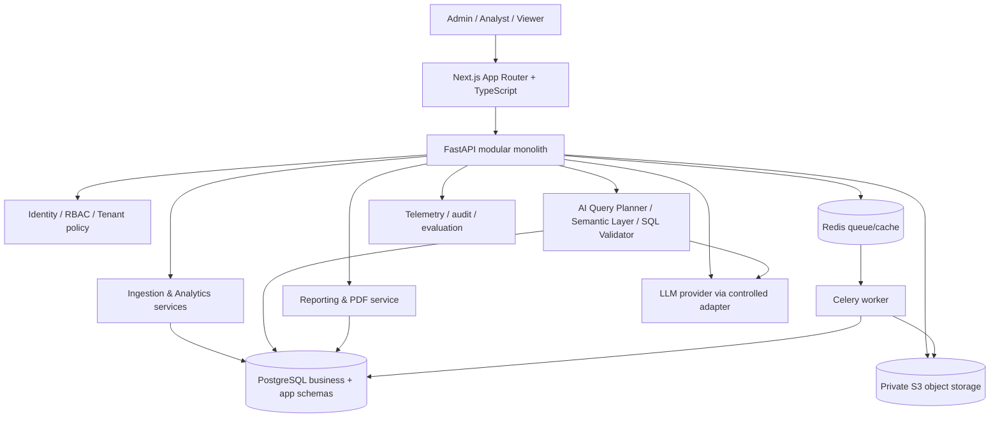
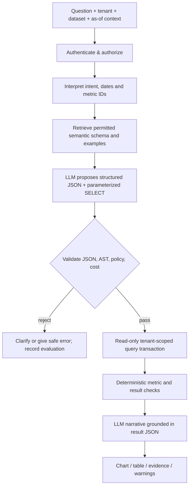
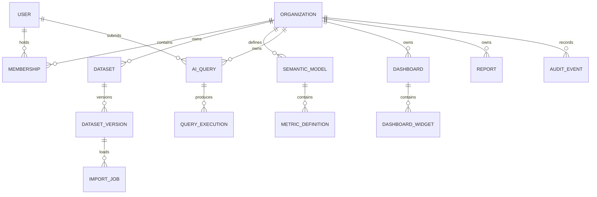

# Contents

| Scope and technical design | Delivery and operations |
|---|---|
| [1. Goals, actors, and release scope](#section-1) | [9. REST API contract (v1)](#section-9) |
| [2. Product requirements and user journeys](#section-2) | [10. Non-functional requirements and observability](#section-10) |
| [3. Architecture and technology decisions](#section-3) | [11. AI quality, safety, and evaluation](#section-11) |
| [4. Canonical business semantics](#section-4) | [12. DevOps, cloud, and operational design](#section-12) |
| [5. Data ingestion, contracts, and reconciliation](#section-5) | [13. Delivery milestones, gates, and acceptance criteria](#section-13) |
| [6. AI question-to-answer system](#section-6) | [14. Implementation guidance for Codex and GitHub](#section-14) |
| [7. Dashboards, reports, forecasts, and decisions](#section-7) | [15. Risks, decisions, and open assumptions](#section-15) |
| [8. Database and persistence design](#section-8) | [Appendix A - Traceability](#appendix-a) |

# Document control and implementation contract

| Field | Value |
|---|---|
| Document | System Design Document (SDD), solution architecture, implementation specification |
| Product working name | InsightForge AI (name is provisional; trademark/domain not checked) |
| Status | **Approved design baseline for future implementation; no code implemented by this document** |
| Target user | Wholesale distributors, retailers, branch managers, analysts, finance and inventory teams |
| Primary technology | Next.js + TypeScript; FastAPI + Python; PostgreSQL; OpenAI API; AWS |
| Architecture | Modular monolith, separate web and API applications, async worker |
| Release strategy | P0 MVP → P1 Professional → P2 Advanced |
| Source of truth | This SDD governs scope; `CODEX_HANDOFF.md` governs agent workflow |

**Purpose.** Provide sufficiently specific product, engineering, security, test, deployment, and acceptance requirements that a coding agent can inspect an existing GitHub repository, plan work, and implement the system incrementally **without silently inventing architecture or deleting existing work**.

**Mandatory Codex rule:** When the repository is provided, **inspect it first**. Produce a gap analysis and implementation plan, then request the owner's explicit instruction before editing files. If repository conventions conflict with this SDD, flag the conflict and propose a decision rather than silently overwriting code. This document itself does not authorize deployment, purchases, external connectors, or production data access.

## Executive overview

InsightForge AI is a **multi-tenant, production-oriented AI business-intelligence SaaS** for wholesale and retail operations. Users upload or connect structured business data; explore deterministic KPI dashboards; ask business questions in natural language; receive **permission-checked, evidence-linked answers**; create management reports; and (later) obtain ML forecasts and anomaly alerts. Its distinguishing engineering emphasis is **business-defined metrics, reconciled multi-source data, independently validated SQL, cross-domain analytical task planning, testable accuracy, and strict tenant isolation**.

Example user question: “Why did our Lahore branch's sales decrease this month, which customers have overdue payments, and which products are likely to run out of stock?” The system should **separate sales trends, receivables ageing, inventory movements, and forecasting**; calculate permitted results; display supporting dates, metrics, SQL/query identifiers, and provenance; then state evidence-supported contributing patterns. It must **not** fabricate causal explanations or treat forecasts as certainty.

**Non-goal:** Building a general-purpose replacement for Power BI, ThoughtSpot, or Zoho. This is a deliberately focused solution for wholesale/retail data and a strong production-minded engineering portfolio project. No claim of category novelty is made.

# 1. Goals, actors, and release scope {#section-1}

## 1.1 Goals and success criteria

- **G1:** A nontechnical business user can answer common sales, stock, and receivables questions without SQL.
- **G2:** All displayed financial metrics follow versioned, approved, testable business definitions.
- **G3:** Every AI analytical answer links to authorized query evidence and data freshness information.
- **G4:** Tenant and user permissions are enforced by trusted application/database controls, never by model instructions.
- **G5:** Ingest validated retail/wholesale data and surface import/reconciliation errors explicitly.
- **G6:** Quantify text-to-SQL reliability, explanation faithfulness, latency, token spend, and denied access attempts.
- **G7:** Provide a deployed, documented demo with synthetic data, tests, CI/CD, and repeatable local setup.

Success requires both a **working workflow** and evidence of correctness. User-visible claims about revenue, profit, or stock must be independently computable from fixtures.

## 1.2 Users, roles, and permission baseline

| Role | Scope and minimum permissions |
|---|---|
| Platform operator | Tenant provisioning/operational status; **no implicit access** to tenant business data |
| Organization Admin | Manage tenant members, uploads, metric definitions, data access, reports and settings |
| Analyst | Read approved datasets, run permitted AI analysis, create dashboards/reports |
| Viewer / Manager | View granted reports and dashboards, run only queries permitted for assigned datasets |

The MVP uses **Admin, Analyst, Viewer**. A user may belong to multiple organizations; membership and active-organization context are server validated on **every** request. Dataset-level permissions are P1; MVP enforces tenant boundary and role restrictions.

## 1.3 Scope by release — definitive prioritization

| Feature / subsystem | P0 MVP | P1 Professional | P2 Advanced |
|---|---|---|---|
| Authentication, organizations, RBAC, audit foundation | Complete | Fine-grained dataset access, sharing | Enterprise SSO optional |
| File ingestion | CSV/XLSX, validation, preview, mapping, imports | Reconciliation across sources, data refresh | Native ERP/CRM adapters |
| Business datasets | Sales, inventory, invoices/payments (synthetic starter fixtures) | Branch/customer analysis, returns, expenses | Multi-entity advanced accounting |
| Business metrics | Approved metric catalog with tests | Versioned, managed semantic models and governance | Organization-configurable domain packs |
| Dashboards | Fixed sales/stock/receivables views and filters | Custom dashboard builder and scheduled refresh | What-if simulations |
| AI analytics | Single-question, one-domain text-to-SQL | Multi-domain task decomposition and result synthesis | Agentic workflows if justified |
| Query safety / evidence | Independent SQL validation, read-only execution, query provenance | Fine-grained evidence & export | Advanced provenance graph |
| Reports | One PDF management report template (on demand) | Scheduled exports, custom report templates | Proactive recommendations |
| AI evaluations | Automated gold-set smoke tests + safety cases | Evaluation dashboard, 150+ validated cases | Drift and regression alerts |
| ML forecasting | Not required | Not required | Demand forecasting, intervals, stockout risk, anomaly detection |
| Language | English | English + optionally Roman Urdu after testing | Urdu and multilingual extensions |
| Tools / integrations | Internal validated APIs only | External data connectors | Optional MCP; LangGraph only if warranted |
| Delivery | Docker local, CI, AWS demo baseline | Hardening, monitoring, rate/cost governance | Scaling and high-availability work |

**Key clarification:** “Multi-source reporting” at P0 means importing the three **business domains** as structured files using human-confirmed mapping. Automated cross-system record matching and reconciliation is **P1**. Cross-domain question planning is **P1**. ML forecasting with explicit uncertainty is **P2**. This prevents an oversized first release.

## 1.4 Explicit exclusions from MVP

- No unrestricted chat-generated SQL against production databases.
- No arbitrary web browsing, unrestricted shell commands, or external write tools for AI agents.
- No automatic refunds, financial postings, inventory purchases, or other real-world actions.
- No real banking, insurance, or customer-private data in public demos.
- No unsupervised causal “why” claims; only supported comparisons and hypotheses.
- No mobile app, billing subscriptions, cross-company data sharing, or microservices at MVP.

# 2. Product requirements and user journeys {#section-2}

## 2.1 Functional requirements (testable IDs)

| ID | Requirement | Priority | Acceptance summary |
|---|---|---|---|
| FR-01 | Registration, login, logout and secure session lifecycle | P0 | Invalid credentials rejected; expired sessions denied |
| FR-02 | Organization creation, invitations and membership roles | P0 | Cross-org access returns 403/404 without data leakage |
| FR-03 | CSV/XLSX upload and file validation | P0 | Invalid size/type/schema fails with useful error |
| FR-04 | Import preview, column mapping and staged data load | P0 | No live business data overwritten on failed import |
| FR-05 | Sales, inventory and receivables KPI dashboards | P0 | Metrics match known database fixture totals |
| FR-06 | Semantic metric catalog and authorized schema | P0 | Metric definitions versioned/tested; no freeform invented metrics |
| FR-07 | Natural-language analytical request and result | P0 | Supported questions yield query + chart/table + explanation |
| FR-08 | AST SQL validation and authorized read-only execution | P0 | DDL/DML, multi-statement, unapproved objects and cross-org access rejected |
| FR-09 | Evidence trail for analytical answer | P0 | Includes data version, filters, metric definitions, query ID, timestamps |
| FR-10 | Query history and error/failure handling | P0 | Allowed users can inspect their tenant's requests |
| FR-11 | On-demand executive PDF report | P0 | Numeric values match underlying verified results |
| FR-12 | Automated test and security evaluation dataset | P0 | CI tests include expected SQL results and hostile attempts |
| FR-13 | Source reconciliation engine and exception reports | P1 | Duplicates, missing keys and mismatches identified before publish |
| FR-14 | Multi-domain analytical planner with combined answer | P1 | Correct decomposition and evidence per sub-question |
| FR-15 | Custom dashboards, sharing and scheduled reports | P1 | Unauthorized share/view denied |
| FR-16 | AI performance/quality evaluation dashboard | P1 | Displays accuracy, safety, latency and cost from recorded runs |
| FR-17 | External read-only PostgreSQL connector | P1 | Credentials protected; allowlisted source, restricted privileges |
| FR-18 | Forecasting, anomaly and stockout risk | P2 | Tested against time-based holdout with uncertainty |
| FR-19 | What-if scenarios, multilingual UI/query and optional MCP | P2 | Explicit per-feature acceptance and safe boundaries |

## 2.2 Core end-to-end journeys

**Journey A — setup and import:** Admin creates org → uploads CSV/XLSX → server validates type/size/content → parses to isolated staging → UI previews mappings → admin confirms mapping → import job validates relationships → data is committed to tenant-authorized business tables → dashboard computes correct metrics. P1 inserts cross-source reconciliation before publishing.

**Journey B — ask the data:** Analyst selects org/dataset → asks “Top five products by net revenue in October” → authorized schema/metric context retrieved → LLM proposes structured query → trusted validator rejects unsafe objects/constructs → read-only DB executes under tenant enforcement → deterministic result checks → chart/table and conservative narrative generated → evidence and latency recorded.

**Journey C — report:** Manager selects date range and report template → report service uses approved KPI queries (not an LLM's invented numbers) → narrative describes validated results → PDF generated → report stored privately with expiring download permissions → audit event emitted.

**Journey D — multi-domain (P1):** Manager asks sales + overdue invoices + stockouts → planner creates bounded, permission-checked subqueries → domain-specific analytics and optional ML run independently → aggregator merges evidence → uncertain or missing data clearly flagged.

# 3. Architecture and technology decisions {#section-3}

## 3.1 System diagram




## 3.2 Final technology baseline and rationale

| Layer | Primary choice | Reason / constraint |
|---|---|---|
| Web | Next.js App Router, React, TypeScript, Tailwind, shadcn/ui | Typed UX, maintainable route/component layout |
| Charts | Apache ECharts (or existing repo's Recharts if suitable) | Interactive financial and time-series charts |
| API | FastAPI, Pydantic, SQLAlchemy, Alembic | Python analytics + typed REST, migrations |
| Database | PostgreSQL, separate `app` and `biz` schemas; read-only reporting role | Relational finance records and tenant controls |
| Data transforms | Pandas; use Polars only if benchmarked | Imports, normalization, aggregates |
| AI | OpenAI API via one adapter; structured JSON outputs | Provider isolation, schema-constrained generation |
| SQL | SQLGlot AST validation **plus** PostgreSQL least-privilege and RLS | Syntax validation alone is not a security boundary |
| Jobs | Redis + Celery | Import/exports/scheduled work and retries |
| Files | S3 production; S3-compatible local object store | Private datasets and report binaries |
| ML P2 | scikit-learn, statsmodels and time-series baselines | Explainable forecasts and anomaly detection |
| Ops | Docker Compose local; AWS ECS/Fargate + RDS + S3 | Deployable without early Kubernetes complexity |
| CI | GitHub Actions; Pytest, Playwright; linters/type checks | Quality gate |

**ADR-01:** Modular monolith, not microservices. Separate frontend and API deployables; group API code by domain. **ADR-02:** Ship deterministic dashboards before AI-generated queries. **ADR-03:** Use governed metrics and SQL safety rather than delegating business logic to LLMs. **ADR-04:** Async jobs for imports and reports. **ADR-05:** Add LangGraph/MCP only when there is a concrete multi-step orchestration or external tool requirement; they are not mandatory dependencies.

## 3.3 Logical backend modules

- `identity`: auth, session rotation, organizations, memberships, invitations.
- `catalog`: data sources, datasets, dataset versions, column mapping and uploads.
- `ingestion`: staging, validation, normalization, import jobs; P1 reconciliation.
- `business`: orders, inventory movements, invoices, payments, customers, products, branches.
- `semantic`: versioned governed metrics, dimensions, approved joins and descriptions.
- `analytics`: deterministic KPI services, time filters, authorized query execution.
- `ai`: structured question parsing, permitted schema selection, SQL proposal, validation, interpretation, eval tracing.
- `reports`: report templates, evidence manifests, PDF tasks, artifact access.
- `forecast`: P2 historical models, uncertainty, monitoring.
- `observability`: security audit, usage, latency, request tracing, evaluation records.

Enforce service boundaries in Python packages without unnecessary internal HTTP calls. Authorization is resolved once in middleware/dependencies and rechecked at each database/data-access boundary.

# 4. Canonical business semantics {#section-4}

The semantic layer is **mandatory P0**. Every computed KPI has `metric_id`, `version`, SQL expression or query template, approved dimensions, required tables, filtering defaults, time zone, currency policy, tests and owner.

| Metric | Initial definition | Important caveat |
|---|---|---|
| Gross sales | Sum of posted sales line amount before discounts and returns | Exclude draft/cancelled orders |
| Net revenue | Posted gross sales − line/order discounts − refunds/returns | Tax and shipping rules explicitly specified by business |
| COGS | Sum of units sold × historical cost-at-sale | Never use today's product cost for past periods |
| Gross profit | Net revenue − COGS, adjusted for returned COGS | Not equal to net profit |
| Order count | Count of distinct eligible completed orders | Avoid double count through joins |
| Average order value | Net revenue ÷ eligible order count | Null/0 when no eligible orders |
| Stock on hand | Opening quantity + sum of signed inventory movements | Per product, branch, as-of date; reservations tracked separately |
| Available stock | Stock on hand − committed/reserved quantity | May require additional reservation records |
| Overdue amount | Invoice balance at as-of date if due date passed | Partial payments and credits required |
| Receivables ageing | Outstanding amount bucketed by days past due | Use fixed as-of date, clear boundary definitions |
| Sales growth % | (Current comparable period − prior period)/abs(prior) ×100 | Zero baseline is undefined, not infinite growth |

**Finance policy baseline:** Default demo uses one currency (PKR or synthetic USD, declared per dataset), Asia/Karachi business time zone, posted-only records, and returns as documented negative adjustments. Multi-currency consolidation, taxes, fiscal-year variants, and GAAP/IFRS-grade accounting are **not MVP promises**. All metric definitions and source fixtures must be tested independently by SQL or arithmetic assertions. State when costs/credits are unavailable and suppress profit estimates rather than guessing.

**Time semantics:** Store timestamps in UTC; normalize display filters to the organization's business time zone. Include end-exclusive date bounds in SQL, e.g. `[2026-10-01, 2026-11-01)` for an October calendar period. Clarify what “this month” means relative to the user's selected business clock.

# 5. Data ingestion, contracts, and reconciliation {#section-5}

## 5.1 P0 file data pipeline

1. Upload via authenticated API to private staging object store; validate file signature, extension, size and content.
2. Parse CSV/XLSX with bounded memory/resource usage; reject macros and unsupported files; set per-tenant quotas.
3. Present column names, preview, detected types, null rates, duplicates, and mapping suggestions. Admin must confirm mappings.
4. Create immutable `dataset_version` and `import_job`; import into staging tables with correlation ID.
5. Validate customer/product/branch keys, required dates, numeric precision, nonnegative rules where appropriate, known statuses, and duplicate source identifiers.
6. On success, publish atomically or via version switch; on failure keep live data unchanged and export errors.
7. Retain provenance: source filename/hash, tenant, uploader, dataset version, mapping version, row counts, import time.

MVP supports **three canonical templates**: (a) sales/orders with line items, (b) products/inventory movements, (c) invoices/payments. Provide downloadable synthetic example files and a data dictionary. Imports should be idempotent by tenant + source + external key + batch version; document whether the operation replaces a dataset snapshot or appends events.

## 5.2 P1 reconciliation engine

Import ERP sales, inventory spreadsheets, and payment CSVs as independent sources; map their keys to a canonical tenant entity registry. Reconciliation stages:

- Normalize IDs, branch codes, units, dates, currencies, and tax rules under tenant-specific mappings.
- Perform deterministic matching on stable source identifiers and mapping tables; only suggest fuzzy matches for human approval.
- Flag duplicated invoices, unmatched payments, missing products, negative stock anomalies, inconsistent totals, and stale snapshots.
- Record all unresolved issues with severity, source rows, rule ID, assigned owner, and resolution status.
- Prevent publishing reports with material unresolved reconciliation failures unless an authorized user explicitly acknowledges limitations; show quality banners.

P1 acceptance: import three files with known mismatches; identify every seeded missing key and duplicate; reconcile partial payments; prevent double counting; retain correction/audit history. This is a business-specific data engineering feature rather than a generic file upload.

## 5.3 External connectors (P1/P2)

Start P1 with a **read-only PostgreSQL connector** (allowlisted host/port, restricted credentials, test connection, schema selection, TLS, secret manager, query timeouts). Never store plaintext passwords in tables or browser state. ERP/CRM APIs are P2 connectors implemented as isolated adapters with mapping rules. Do not enable arbitrary user-provided database queries.

# 6. AI question-to-answer system {#section-6}

## 6.1 Safe request processing




**Prompt inputs:** only approved schema fragments, glossary, metric IDs, allowed dimensions, redacted examples, permitted date context, and a bounded user question. Treat user questions and imported data as untrusted. Never place API keys, customer secrets, or general database catalog in the prompt.

**Typed SQL proposal contract (illustrative):**

```json
{
  "intent": "ranking",
  "metric_id": "net_revenue",
  "metric_version": 1,
  "dimensions": ["product_name"],
  "filters": [{"field": "order_date", "operator": "between", "values": ["2026-10-01", "2026-11-01"]}],
  "time_zone": "Asia/Karachi",
  "sql_template": "SELECT ... FROM approved_sales_view WHERE ... LIMIT :limit",
  "parameters": {"limit": 5},
  "visualization_hint": "bar",
  "needs_clarification": false
}
```

The schema is validated with Pydantic. The server re-resolves fields/joins/metric definitions from its **own allowlist**. The model's `sql_template` is only a proposal, not executable authority. SQL may also be generated from a restricted query DSL rather than direct freeform SQL when possible.

## 6.2 Mandatory SQL and data safety design

**Defense-in-depth:** independent tenant authorization → governed SQL AST/DSL allowlists → parameter binding → server-managed tenant context → **separate least-privilege DB execution role** → PostgreSQL RLS/approved security-barrier views → read-only transaction and resource caps → result validation.

- Permit a **single** `SELECT` query (including approved joins, aggregations, and bounded CTEs); reject all DML/DDL, stored procedures, system schemas, unsafe functions, dynamic SQL, session changes, multi-statements, and nested writes.
- Restrict table/view/column names to per-tenant authorized reporting objects, and approved aggregation functions. SQLGlot is a parser/policy aid, **not** the whole security mechanism.
- Use parameterized values, PostgreSQL role with `SELECT` on approved reporting views only, no ownership, no `BYPASSRLS`, and no permission to create functions or read secrets.
- Enforce RLS for shared tenant rows; use security-invoker reporting views where supported, and configure table ownership/FORCE RLS so view ownership cannot silently bypass tenant policies. Set trustworthy tenant context **only in server-controlled transaction boundaries**, after membership verification. A query cannot override this context, and the SQL policy rejects statements/functions that might change it.
- Apply `statement_timeout`, `lock_timeout`, bounded result limits, bounded joins / cost checks, and cancellation; use connection pooling with transaction-local isolation to avoid context leakage.
- Query service should use a separate DB connection/pool from operational app writes. Run attack-focused tests, including malicious CTEs, `UNION`, system catalog access, `pg_sleep`, injected filters, and cross-tenant requests.
- Treat all outputs as sensitive; charts and exports must undergo the **same** authorization and masking controls as raw query results.

**Query failure behavior:** Return `clarification_required`, `unsupported_metric`, `query_rejected`, `query_timeout`, `insufficient_data`, or `execution_error` with user-safe messages; never leak SQL credentials, stack traces, or rows from other tenants. Optionally allow **one bounded repair attempt** for syntax/shape errors, re-running all gates; no retries that bypass security.

## 6.3 Evidence, grounding, and analytical integrity

Each successful answer includes: `question_id`, `dataset_version_ids`, `metric_id/version`, `as_of`, filter ranges, `query_hash` and safe SQL preview, execution timestamp, row count, chart spec, tabular result, narrative, caveats, cost/latency, and correlation ID. P1 also includes reconciliation quality and component-level subquery evidence.

Narratives may identify patterns consistent with observed data (e.g., fewer orders and lower average order value) but must not assert *causality* without supporting experiment or external evidence. If a computed value is unavailable, say so. Forecasts must be labeled predictions and show prediction intervals.

## 6.4 Cross-domain analytical orchestration (P1)

Use a bounded planner that converts a multi-intent question into at most **four** typed tasks: `sales`, `receivables`, `inventory`, `forecast`. For each task: authorize data domain, select semantic metrics, execute deterministic/statistical service, capture evidence and status. Aggregate into one report with per-task provenance and limitations. Only the forecast task is enabled when P2 ML exists; before then report that forecast is unavailable rather than manufacture it. Avoid agent self-delegation loops; make parallelism and budget limits explicit. Introduce LangGraph only if testing shows it simplifies state, retries, and approval checkpoints.

# 7. Dashboards, reports, forecasts, and decisions {#section-7}

## 7.1 Screens and navigation

1. **Login / registration / organization switcher.**
2. **Overview:** high-level cards, trends, data freshness badges, data quality issues.
3. **Data Sources:** file upload, dataset previews, mapping wizard, import status, source versions.
4. **Ask AI:** question input, suggested prompts, results table/chart, query evidence drawer, history.
5. **Sales Analytics:** revenue/net revenue/orders/AOV, branch/product/customer filters.
6. **Inventory:** movements, on-hand, low stock; forecasts only in P2.
7. **Receivables & Finance:** invoice balances, ageing buckets, payments, gross profit when cost data is reliable.
8. **Dashboards:** fixed P0 dashboards; P1 custom widget builder.
9. **Reports:** on-demand PDF; P1 schedules, history and download access.
10. **AI Quality:** P1 evaluation scorecards; technical smoke results available in CI at P0.
11. **Team & Settings:** members/roles, metric catalog, organization time zone and currency, audit events.

P0 UI supports responsive desktop and tablet sizes; mobile may show responsive views, **not** a native app.

## 7.2 Executive report requirements

P0 `Monthly Business Performance` report sections: reporting period and data freshness; net revenue/orders/AOV with comparisons; top products and branch results; inventory position; overdue receivables; evidence appendix (metric definitions, source versions, query IDs, exceptions). PDF must be generated from **trusted aggregated result objects**, not AI-generated values. LLM may draft narrative only from those objects. Private storage, per-org access, expiring download URLs, and report audit records are required.

## 7.3 Predictive ML (P2)

- Forecast daily/weekly product or branch demand using seasonal naive baseline and at least one selected statistical/ML model; benchmark by rolling-origin backtests, not random split.
- Report WAPE/MAE (with appropriate treatment of zeros), model version, training window, evaluation window, forecast horizon, prediction intervals or explicit calibrated uncertainty method.
- Stockout risk combines projected demand, on-hand stock, expected supply and lead time. Forecast is advisory, never automatic purchasing.
- Anomaly detection uses transparent seasonal thresholds first, then optional statistical/ML detectors; always provide underlying observed changes and false-positive controls.
- What-if simulations accept explicit assumptions (e.g. supplier cost +8%) and show deterministic scenario formulas separate from forecasts.
- Alerting/scheduled monitoring is P2; retain metric source, rule version, last evaluation, and notification status.

# 8. Database and persistence design {#section-8}

## 8.1 Core entity diagram




## 8.2 Application schema — minimum tables

| Table | Critical columns / constraints |
|---|---|
| `app.organizations` | id (UUID PK), name, default_tz, currency, created_at, status |
| `app.users` | id, email unique, password_hash (if local auth), is_active, created_at |
| `app.memberships` | org_id, user_id, role enum, status; unique(org_id,user_id) |
| `app.sessions` | id, user_id, hashed_refresh_token, expires_at, revoked_at, device metadata |
| `app.data_sources` | id, org_id, type, label, secret_ref, status, updated_at |
| `app.datasets` | id, org_id, name, domain, active_version_id, created_at |
| `app.dataset_versions` | id, dataset_id, org_id, file_hash, storage_key, schema_snapshot, row_count, published_at |
| `app.import_jobs` | id, org_id, dataset_version_id, status, rows_ok, rows_bad, error_manifest, timestamps |
| `app.column_mappings` | id, org_id, dataset_id, version, mapping_json, confirmed_by |
| `app.semantic_models` | id, org_id, name, version, approved_at, allowed_objects |
| `app.metric_definitions` | id, org_id, model_id, metric_key, expression_config, version, tests_json |
| `app.ai_queries` | id, org_id, user_id, question_redacted, intent, status, created_at |
| `app.query_executions` | id, org_id, ai_query_id, query_hash, sql_preview, metric_versions, evidence_json, duration_ms, status |
| `app.dashboards` / `widgets` | id, org_id, owner_id, title, layout_json / chart_config_json |
| `app.reports` | id, org_id, created_by, template, period, storage_key, evidence_manifest, status |
| `app.audit_events` | id, org_id, actor_id, event_type, resource_type/id, metadata_redacted, created_at |
| P1 `reconciliation_runs` / `issues` | org_id, dataset_versions, rule_key, severity, row_refs, resolution_status |
| P1 `eval_runs` / `eval_cases` | case_id, org_id optional, expected result, observed result, safety flags, run stats |
| P2 `forecast_runs` | org_id, model_version, horizon, train_end, metrics, interval_data, evidence |

**Keys/indexes:** Use UUID PKs, foreign keys, `org_id` on all tenant-owned records, composite `(org_id, created_at)` and `(org_id, business_key)` indexes as needed, tenant-scoped unique constraints, and query-specific partial indexes validated with `EXPLAIN`. Use numeric/DECIMAL for money, not floating point.

## 8.3 Canonical business schema

| Table | Representative columns and invariants |
|---|---|
| `biz.branches` | id, org_id, external_id, name, city; unique(org_id,external_id) |
| `biz.customers` | id, org_id, external_id, name, region |
| `biz.products` | id, org_id, sku, name, category, base_unit |
| `biz.orders` | id, org_id, external_id, customer_id, branch_id, ordered_at, status, currency |
| `biz.order_items` | id, org_id, order_id, product_id, qty, unit_price, discount, cost_at_sale |
| `biz.returns` / `return_items` | org_id, original_order_id, return_date, quantity, refund amount, cost reversal |
| `biz.inventory_movements` | org_id, product_id, branch_id, movement_at, signed_quantity, type, source_ref |
| `biz.inventory_reservations` | P1; org_id, product_id, branch_id, reserved_qty, status |
| `biz.invoices` | id, org_id, customer_id, order_id nullable, invoice_date, due_date, amount, status |
| `biz.payments` | id, org_id, invoice_id, paid_at, amount, currency, source_ref |
| `biz.credit_notes` | P1; org_id, invoice_id, issued_at, amount |
| `biz.expenses` | P1; org_id, branch_id, posted_at, category, amount |

**Referential rule:** Use composite keys or validated joins that include tenant identity so a branch/customer/product from one organization cannot be linked to another. Add foreign keys, check constraints, unique external source IDs, and test fixtures for orphaned references. Prefer ledger-style inventory movements rather than mutable stock totals.

## 8.4 Authorization and isolation at rest

Enable PostgreSQL RLS on tenant-owned app and business tables where used; a reporting user sees only approved read-only views. RLS policies must be tested with two independent tenant fixtures and multiple roles. Do not grant app roles owner privileges or `BYPASSRLS`. Production backups, object paths, and caching also have tenant scoping. Keep encrypted secrets and PII out of analytics logs.

# 9. REST API contract (v1) {#section-9}

All APIs live under `/api/v1`. Use standard JSON envelopes, OpenAPI-generated documentation, correlation IDs, consistent pagination, UTC timestamps, and server-side authorization. For a multi-step operation, return `202 Accepted` with job ID.

| Method | Path | Purpose | Priority |
|---|---|---|---|
| POST | `/auth/register` | Sign up | P0 |
| POST | `/auth/login` | Login and session cookies | P0 |
| POST | `/auth/refresh` | Rotating session refresh | P0 |
| POST | `/auth/logout` | Revoke session | P0 |
| GET | `/auth/me` | Current identity and memberships | P0 |
| POST | `/organizations` | Create organization | P0 |
| GET | `/organizations/{orgId}/members` | List authorized members | P0 |
| POST | `/organizations/{orgId}/invitations` | Invite member | P0 |
| POST | `/datasets/uploads` | Create validated upload intent | P0 |
| POST | `/datasets/{datasetId}/versions` | Confirm parsed upload/mapping | P0 |
| GET | `/datasets/{datasetId}/preview` | Staged preview and errors | P0 |
| POST | `/datasets/{datasetId}/imports` | Submit async import | P0 |
| GET | `/jobs/{jobId}` | Import/report job status | P0 |
| GET | `/metrics` | Authorized semantic metrics | P0 |
| GET | `/analytics/overview` | Trusted KPI aggregates | P0 |
| GET | `/analytics/sales` | Sales, products, branches | P0 |
| GET | `/analytics/inventory` | Stock and movements | P0 |
| GET | `/analytics/receivables` | Overdue invoices / ageing | P0 |
| POST | `/ai/queries` | Start validated analytical query | P0 |
| GET | `/ai/queries/{queryId}` | Result, chart, status, evidence | P0 |
| GET | `/ai/queries` | Tenant- and user-scoped history | P0 |
| POST | `/reports` | Generate PDF report | P0 |
| GET | `/reports/{reportId}` | Report info and authorized download | P0 |
| POST | `/reconciliation-runs` | P1 cross-source validation | P1 |
| GET | `/evaluations/runs` | Quality dashboard results | P1 |
| POST | `/ai/analyses` | Multi-domain orchestrated question | P1 |
| POST | `/dashboards` | Custom dashboard config | P1 |
| POST | `/forecasts` | Forecast job | P2 |

**Example — `POST /api/v1/ai/queries`:**

```json
{
  "organization_id": "<uuid>",
  "dataset_ids": ["<uuid>"],
  "question": "Top five products by net revenue in October 2026",
  "business_time_zone": "Asia/Karachi",
  "requested_visualization": "auto"
}
```

**Successful synchronous example (or response from `GET` if async):**

```json
{
  "query_id": "<uuid>",
  "status": "completed",
  "answer": "The five leading products are shown below for the selected period.",
  "result": {"columns": ["product_name", "net_revenue"], "rows": []},
  "visualization": {"type": "bar", "x": "product_name", "y": "net_revenue"},
  "evidence": {
    "metric_key": "net_revenue",
    "metric_version": 1,
    "dataset_versions": ["<uuid>"],
    "period_start": "2026-10-01",
    "period_end_exclusive": "2026-11-01",
    "query_hash": "sha256:...",
    "generated_at": "2026-11-17T00:00:00Z",
    "warnings": []
  },
  "usage": {"latency_ms": 0, "llm_tokens": 0}
}
```

The zero metrics and empty rows above are **schema placeholders**, not a real query result. `organization_id` from the request is validated against the authenticated membership and cannot grant access by itself.

**Errors:** `400 invalid_request`, `401 unauthenticated`, `403 forbidden`, `404 not_found` (avoid exposing existence of other tenant resources), `409 import_conflict`, `422 unsupported_metric/clarification_required`, `429 rate_limited`, `503 model_or_database_unavailable`; include `code`, safe `message`, `correlation_id`, optional `details`.

**Auth decision:** Short-lived access session with HttpOnly/Secure/SameSite cookies and server-managed rotating refresh sessions (hashed tokens) is the baseline. Use HTTPS and CSRF protections on state-changing requests; avoid storing bearer tokens in localStorage. Codex may adapt this to a safe existing auth system after documented review.

# 10. Non-functional requirements and observability {#section-10}

| ID | Category | Baseline engineering target |
|---|---|---|
| NFR-01 | Correctness | All predefined KPI fixtures pass deterministic checks; no fabricated numbers |
| NFR-02 | Isolation | All cross-tenant and role-violation tests denied; zero observed leakage in suite |
| NFR-03 | Dashboard response | Target p95 < 2 s for representative indexed fixture dataset and target infrastructure |
| NFR-04 | AI query response | Target p95 < 15 s for supported simple queries; fail safely at timeout |
| NFR-05 | Availability | Health checks, explicit degraded mode, retryable jobs, RDS backups |
| NFR-06 | Data integrity | Atomic dataset publish, idempotent imports, no partial visible data |
| NFR-07 | Auditability | Record auth changes, uploads, metric edits, queries, exports, denied actions |
| NFR-08 | Privacy | Tenant-scoped logging and storage; avoid sensitive raw prompts/results in routine logs |
| NFR-09 | Scalability | Bounded worker concurrency, database pooling, cursor pagination, async exports |
| NFR-10 | Accessibility | Keyboard access, contrast, form labels, understandable chart alternatives |
| NFR-11 | Operations | CI gate, staging config, secret manager, alerting on failures and cost |
| NFR-12 | Reproducibility | Dev environment via Docker Compose and seeded synthetic datasets |

These are **acceptance targets to measure, not claims of existing performance**. Capture request/trace IDs across frontend, API, worker, SQL execution and model calls. Record prompt/template version, model identifier, token counts, latency, query rejection reason and dataset version; mask business-sensitive content and set bounded retention. Add cost guardrails per organization and request.

# 11. AI quality, safety, and evaluation {#section-11}

## 11.1 P0 CI evaluation set

Provide **at least 30** independently verified questions spanning sales, stock and receivables (exact-match result fixtures, not merely expected SQL strings) plus **at least 15** adversarial/security cases. Cover joins, date boundaries, zero denominators, nulls, cancelled orders, partial invoices, ambiguous questions, missing data, injected instructions, hostile SQL, tenant crossover, and unauthorized columns.

Evaluation metrics: (1) execution validity; (2) answer result correctness; (3) governed metric selection; (4) explanation faithfulness; (5) permission-policy rejection rate; (6) latency/cost. Report case-level results and aggregate denominators. Do not equate SQL string similarity with correctness: distinct SQL can compute the same answer. For unsafe input, “correct” may mean refusal or clarification.

## 11.2 P1 evaluation dashboard

Grow to **150+** representative annotated questions with held-out fixtures, grouped by question type/complexity/business domain. Track model/prompt/semantic-version regressions, execution accuracy, hallucination/safety flags, tool/SQL denials, p50/p95 latency and cost per query. Preserve a pinned baseline run so model migrations can be evaluated quantitatively. The **BIRD benchmark** is a methodological reference (https://bird-bench.github.io/), not an assumed score for this application.

## 11.3 Security and failure test scenarios

- Tenant A cannot query, export, preview, guess IDs of, or cache-hit Tenant B's resources.
- Viewer cannot import source data or modify metric definitions.
- Prompt attempts to change SQL permissions or read passwords are ignored/denied.
- CTE with nested modification, second SQL statement, forbidden function/system catalog access are blocked.
- Malformed Excel, duplicate source keys, integer overflow, absent historical unit cost, and corrupt upload trigger safe error states.
- Worker job retried twice cannot produce duplicate records or repeated report notifications.
- AI service outage leaves deterministic dashboards working and surfaces correct degraded state.
- Report PDFs and object downloads cannot be accessed without per-request authorization.

# 12. DevOps, cloud, and operational design {#section-12}

## 12.1 Environments and deployment

- **Local:** Docker Compose `web`, `api`, `worker`, PostgreSQL, Redis and S3-compatible object storage; seeded synthetic data; `.env.example` with non-secret placeholders.
- **CI:** Lint/type check, Python and frontend tests, schema migration verification, API contract tests, a small SQL/AI safety suite, secret/dependency scanning, Docker builds.
- **Staging:** AWS ECS/Fargate services for web and API and a worker task; RDS PostgreSQL; S3 private buckets; managed secret storage; TLS/HTTPS and network restrictions. The exact edge/CDN arrangement can adapt to repo and budget.
- **Production (later):** Same architecture with access logging, backups/restore drills, dashboards, alerts, lifecycle retention and hardened IAM.

Use infrastructure-as-code where practical, with separate configurations, no hard-coded resource names or keys, least-privilege IAM, and an explicit shutdown/budget plan for the portfolio demo. Do not assume a cloud account is connected or that deployments are pre-approved.

## 12.2 Background jobs and cache

Jobs: `parse_upload`, `import_dataset`, `reconcile_sources` (P1), `generate_report`, `evaluate_ai` (P1 UI), `refresh_dashboard` (P1), `run_forecast` (P2). All jobs have correlation ID, tenant ID, attempt count, max retries, idempotency key, timeout, progress and terminal status. Retry transient failures only; send irrecoverable jobs to a failure queue with actionable diagnostics. Cache keys contain tenant + auth scope + metric version + dataset version + time filters; never cache cross-org raw results.

## 12.3 Suggested codebase structure

```text
insightforge-ai/
  frontend/
    app/                  # Routes and layouts
    components/           # Shared UI
    features/             # analytics, datasets, ai, reports, auth
    lib/                  # typed API client, auth, formatters
    tests/
  backend/
    app/
      api/v1/             # versioned routers
      core/               # config, security, database, exceptions
      identity/           # users, organizations, sessions
      catalog/            # data sources, datasets, imports
      business/           # canonical business entities
      semantic/           # metric catalog
      analytics/          # deterministic queries
      ai/                 # text-to-SQL orchestration, validation, evidence
      reporting/          # exports
      forecast/           # P2 ML
      jobs/               # worker tasks
      observability/      # audit, traces, eval
      main.py
    alembic/
    tests/
  data/
    synthetic/            # generated, safe sample datasets
    evaluation/           # annotated question/result fixtures
  infra/
    docker/
    terraform/            # optional, reviewed before use
  docs/
    SYSTEM_DESIGN.md      # copy of this SDD
    adr/                  # architecture decision records
    api/                  # OpenAPI and contract examples
    security/             # threat model and policy tests
    evaluations/          # methods and baseline reports
  .github/workflows/
  AGENTS.md
  docker-compose.yml
  .env.example
  README.md
```

Adapt to an existing repository after auditing it; do not create duplicate or nested repos.

# 13. Delivery milestones, gates, and acceptance criteria {#section-13}

| Milestone | Outputs | Mandatory gate before progressing |
|---|---|---|
| M0: repository assessment | Inventory of existing code/dependencies, gap report, ADRs, implementation sequence | Owner approves conflicts/changes; no destructive actions |
| M1: foundation | Monorepo, booting UI/API/DB/Redis, migrations, health checks, CI | Clean checkout starts locally; tests pass |
| M2: identity + upload | Auth, org membership, tenant RLS, file upload/preview, staging, import | Two-tenant negative tests; good/bad file fixtures pass |
| M3: deterministic BI | Semantic catalog, sales/inventory/receivables aggregates, charts | Exact fixture KPI totals, filter and date tests pass |
| M4: AI query engine | Structured question parsing, permitted schema, SQL validator, read-only execution, evidence | ≥30 gold cases + ≥15 safety cases run; failures documented |
| M5: reports | PDF template, history, secure downloads, basic audit | PDF numbers match fixtures and permission checks pass |
| M6: P1 professional | Reconciliation, multi-domain planning, custom dashboards, schedules, evaluation UI, Postgres connector | Cross-source reconciliation and orchestration acceptance fixtures pass |
| M7: P2 ML | Forecast, intervals, backtests, anomalies, optional scenarios | Outperforms/compares transparently with baseline; no leakage |
| M8: release | Docker, AWS staging/demo, CI/CD, monitoring, documentation, security review | Live demo passes end-to-end walkthrough and restore test |

**Prioritization note:** M6 and M7 are **not required** to call the core P0 MVP complete. Milestones may be split into smaller PRs. Do not mark a milestone “complete” solely because files were generated.

## 13.1 P0 Definition of Done

P0 is complete only when: a fresh developer can start the app; org A and B isolation is tested; an admin can upload and publish all three canonical data domains; fixed KPI views match independent arithmetic; analyst can ask supported questions with safe SQL and evidence; basic PDF report exports correct totals; failure states are clear; CI green; README includes setup, synthetic demo credentials (non-sensitive), architecture, known limitations and demo script.

## 13.2 Demo script for interview/recruiters

1. Create organization and invite Analyst + Viewer.
2. Upload sales, inventory, and invoice/payment example files; show validation and staged preview.
3. Open sales/stock/receivables dashboards with correct, filterable KPIs.
4. Ask “Top five products by net revenue in October”; open safe SQL/evidence drawer.
5. Ask unsupported or malicious query; demonstrate refusal rather than fabricated answer.
6. Download monthly PDF report; trace a figure to a metric and dataset version.
7. Switch to another organization; demonstrate no access to the first tenant's data.
8. Show test suite, query evaluation outcomes, and Docker/AWS deployment topology.
9. If P1 complete, run a multi-domain question and reveal reconciled source discrepancies.
10. If P2 complete, show forecast vs. baseline with uncertainty.

# 14. Implementation guidance for Codex and GitHub {#section-14}

## 14.1 Required repository-first behavior

1. Clone/open the **user-supplied** GitHub repository. Check branch, `git status`, README, files, package manifests, framework versions, existing tests, environment templates, migrations, and any `AGENTS.md`.
2. Do **not** run destructive commands, reset history, remove code, rewrite `.git`, change remote URLs, reveal credentials, or push/deploy without explicit instruction.
3. Create `docs/SYSTEM_DESIGN.md` from this design if it is not already present; preserve the original document.
4. Produce a **gap analysis**: existing vs required features, possible reuse, conflicting libraries, missing migrations/security, changes by milestone.
5. Propose implementation PRs and tests, then await approval to start **M1 only**. Each later milestone receives separate permission.
6. At each milestone, generate code + migrations + tests + updated docs; execute tests and report exact outcomes and known gaps.
7. Keep commits small; use descriptive branches, commit messages and PR summaries. Do not claim unexecuted tests passed.

## 14.2 Copy/paste Codex kickoff instruction

> Read `docs/SYSTEM_DESIGN.md` and `CODEX_HANDOFF.md` in full. Inspect the existing repository and current branch. **Do not implement or modify anything yet.** Produce a concise repo audit, conflicts with the approved design, a release-scoped implementation backlog (P0/P1/P2), architecture decisions that need owner confirmation, and an M1 plan with concrete files, tests, migrations, and acceptance criteria. Never assume the repository is empty, and never overwrite existing code or secrets. Begin implementation only after I explicitly approve M1.

## 14.3 Codex execution prompt (after owner approval)

> Implement **only milestone M1** from `docs/SYSTEM_DESIGN.md`, adapting to the existing repo. Write tests and documentation with the code. Use secure configuration, type checks, and migrations. After implementing, run available checks; report commands, passed/failed tests, new files, risks, and exact manual verification steps. Do not modify other milestones, deploy, or push unless separately authorized.

# 15. Risks, decisions, and open assumptions {#section-15}

| Risk / ambiguity | Mitigation / design decision |
|---|---|
| LLM invents SQL, metrics or causal explanations | Approved semantic layer; independent results; grounded narrative; evaluation and caveats |
| Tenant or role data leakage | Server-side membership check, DB RLS/read-only views, negative tests, scoped caches |
| Cross-source duplicates and mismatched accounting | P1 reconciliation, immutable source versions, human-confirmed mappings, quality flags |
| Long/expensive queries | Restricted schema, cost/row/timeout limits, cancellation, quotas and logs |
| Incorrect historical profit | Store cost at sale, returns adjustments; display unknown when evidence missing |
| Forecast overconfidence | Baselines, time-split validation, uncertainty and prominent prediction labels |
| Large feature scope | P0/P1/P2 gates, strict exclusions, incremental PRs |
| Vendor and cloud expense | Configurable model, token caps, fixtures without API calls, demo cost budget |
| Product/name uniqueness | Treat name as working title; verify legal/branding availability before launch |
| Repository unknown | Mandatory M0 audit and non-destructive integration plan |

**Assumptions locked for implementation unless owner explicitly changes them:** The first demo is a wholesale/retail business with a single base currency and Asia/Karachi business time zone; test data is **synthetic only**; Postgres is the authoritative analytical store; platform has three core tenant roles; no paid subscriptions or live ERP actions; model provider accessible by environment-configured API key; cloud resources and repository writes require user permission; no claim that this is a globally unique idea.

# Appendix A — Definition of requirements traceability {#appendix-a}

| Product objective | Primary requirements | Core verification |
|---|---|---|
| Secure SaaS workspaces | FR-01, FR-02, FR-08 | Organization cross-access and role-negative tests |
| Reliable data ingestion | FR-03, FR-04, FR-13 | Import validation, idempotency, reconciliation fixtures |
| Deterministic business intelligence | FR-05, FR-06 | SQL fixture totals, boundary/currency tests |
| Trustworthy natural-language analysis | FR-07, FR-08, FR-09 | Gold-set result accuracy, AST/policy adversarial suite |
| Business communication | FR-10, FR-11, FR-15 | PDF number match, report permission checks |
| Measured AI quality | FR-12, FR-16 | Reproducible recorded evaluation runs |
| Differentiated advanced functionality | FR-14, FR-18, FR-19 | Planner evidence, forecasts vs baselines, scenario tests |

# Appendix B — Project documentation bundle checklist

- `SYSTEM_DESIGN.md` (this document; architecture and requirements source of truth)
- `CODEX_HANDOFF.md` (instructions and implementation discipline)
- Optional `AGENTS.md` in repository root (Codex guardrails without secrets)
- `README.md` with local Docker steps, env variables, synthetic data and demo flow
- `docs/adr/` for significant architecture choices and deviations
- `docs/api/openapi.json` generated from FastAPI after APIs are implemented
- `docs/evaluations/` pinned test data, expected results, baseline reports
- `docs/security/` threat model, tenant isolation tests, SQL policy decision log
- `data/synthetic/` import fixtures and independent expected KPI totals

**Industry references for design inspiration (not code to copy):** Wren AI: https://github.com/Canner/WrenAI ; BIRD evaluation: https://bird-bench.github.io/ ; OWASP LLM Top 10: https://genai.owasp.org/llm-top-10/ . Verify licenses before reuse.

---

**Specification status:** Finalized as a **development baseline**, subject to M0 repository audit and normal change control. It describes *to-be-built requirements*, not features already implemented. The owner must approve implementation and deployment independently.
