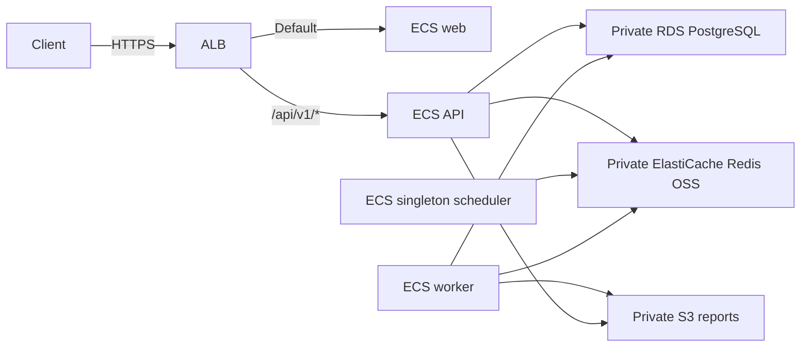

# M8 release preparation

## Order of work

1. Build and verify hardened runtime images, keeping local Compose and the migration image usable.
2. Validate staging network, runtime identities and recovery procedures before promoting image digests.
3. Run the synthetic demo and measure latency under controlled concurrency before approving staging.

## Staging topology

Build the frontend with the staging HTTPS origin for `NEXT_PUBLIC_API_BASE_URL`. Keep browser requests same-origin, enable secure session cookies, and use `/api/v1/ready` for the API target group. The ALB and tasks use private subnets in two availability zones. The stack has no default Internet route. ECR, CloudWatch Logs and Secrets Manager use interface endpoints. S3, including ECR layers, uses a gateway endpoint. Arrange operator connectivity and private DNS from the approved network before enabling services. The ALB accepts HTTPS from the supplied CIDRs. The scheduler uses stop-before-start replacement.

Use TLS-backed Redis OSS for Celery, with authentication, disabled cluster mode and certificate verification. Require `rediss://` with `ssl_cert_reqs=required` in the broker secret. Test broker reconnection and redelivery before staging. The Terraform deliberately leaves external AI and PostgreSQL connector egress disabled. Adding either requires a reviewed private or narrowly controlled network path.

Issue separate task identities for web, API, worker and scheduler. Use Secrets Manager references for required database URLs and broker credentials. Keep schema-owner credentials scoped to the one-off migration task. API needs report download access, while worker needs report publication access. Keep artifact storage private and preserve application-level authorization on downloads. Rotate secrets by issuing new values, replacing affected tasks, verifying health and then retiring the old values.

The cloud bootstrap requires an existing ACM certificate, SNS alarm topic, private operator connectivity and managed secrets. Set `start_services=false` during bootstrap. Populate the ECR repositories with the selected immutable image digests. Use the RDS-managed administrator only from the authorized bootstrap path to create restricted application and reporting roles, revoke public database access and create the schema-owner login. Give the migration principal the rights needed to create or assume `insightforge_view_owner` for migration `0003_m4`. Check PostgreSQL 16 role membership on a disposable cloud-shaped PostgreSQL database before enabling services. Use `sslmode=verify-full` and the approved RDS CA for database DSNs. The Redis AUTH input is sensitive but can persist in Terraform state. Use encrypted remote state with restricted operator permissions and protect all plan artifacts before any authorized cloud use.

### Operator access and release authorization

Use an existing identity-controlled VPN or approved AWS Client VPN connection into the staging VPC. Route only the staging network, authorize the demo group, and use private DNS to resolve the demo hostname to the internal ALB. Align the ALB rule with the observed source address or Client VPN security group, and verify TLS hostname matching from a connected client. The VPN, its authentication, routed DNS and certificate issuance are prerequisites outside this Terraform root. Confirm that the same hostname does not resolve to a public entry point. Use synthetic demo tenants and accounts only.

Configure the GitHub `staging` environment with required reviewers, self-review prevention, and a deployment branch rule allowing main only. The manually dispatched staging review workflow checks that the exact main commit passed both required workflows. It has read-only permissions and performs release review. Any future deployment workflow requires separate approval and a short-lived OIDC role restricted to that repository and environment.

If live OpenAI use is separately approved later, put a dedicated egress proxy on a separately routed network segment. Permit HTTPS only from the designated API/worker security group to the proxy, and enforce the approved OpenAI hostname at the proxy without permitting arbitrary CONNECT destinations. Keep direct egress closed, validate upstream TLS and route DNS through the approved resolver. Inject the model credential from a narrowly scoped secret, set limits and measure cost separately. The existing private configuration leaves model egress disabled.

## Migration and recovery

Record the current revision, immutable image digests and RDS restore point. Run one migration task with the schema-owner identity before switching service traffic. Verify the expected Alembic head, restricted app and reporting roles, and a two-tenant read/write denial check. Confirm that report access and queued jobs still work before increasing traffic.

For application rollback, restore the previous service task definitions only after checking compatibility with the migrated schema. Prefer a corrective migration for schema problems. Rehearse PITR by restoring into an isolated instance, repeating the migration and tenant checks, comparing fixture totals and reporting restore duration and the recovered timestamp. Verify artifact references and separately reconcile jobs queued around the restore point. Never overwrite the active instance as part of rehearsal.

## Release gates

- The existing CI workflow covers application regressions and migration/integration checks. The release workflow adds image builds and security scans. Require both workflows in branch protection before promoting images.
- Configure a protected GitHub staging environment with required reviewers and narrowly scoped short-lived identity. Run deployment only from an explicit dispatch against reviewed immutable image digests, after approval.
- Track API error rate and latency, database saturation and slow-query aggregates, queue age, and failures for reports, forecasts and reconciliation. Aggregate AI latency and token counts without logging prompts or results. Notify operators on availability, security and budget thresholds.
- For the controlled latency exercise, report fixture scale, concurrency, host specifications, mock/provider mode, error rate, throughput and p50/p95 per workflow. Compare dashboard p95 to 2 seconds and approved simple AI query p95 to 15 seconds. Treat offline model timing as a separate measurement.
- Use the SDD walkthrough with synthetic accounts and data. Include unsupported AI, denied cross-tenant download, and unavailable forecasts as degraded-path checks.

## Release checklist

| Gate | Status |
|---|---|
| M7 baseline | Verified on main. |
| Containers | Both images built locally. Local Compose hardening preserved. |
| Staging IaC | VPC, endpoints, internal ALB, ECS, IAM, ECR, RDS, Redis, report S3/KMS and monitoring defined. Cloud planning, bootstrap, provider connectivity and release approval remain pending. |
| Frontend gates | Windows lint, typecheck, Vitest and Next production build passed outside the restricted runtime path. |
| Monitoring | API and SQL latency, Celery execution and retry, job failure, provider usage, default queue depth, delivery delay and reconciliation issue counts. Nine alarms cover availability, error/retry bursts, backlog, delivery wait and RDS CPU. |
| Remaining observability | Oldest still-enqueued item, priority queues, request/error ratios and privacy-reviewed browser telemetry. ECS Container Insights provides a managed resource-monitoring path for ECS; live resource metrics remain unverified. |
| Release CI | Build, dependency, secret and IaC checks defined. GitHub execution awaits separate publication approval. Existing CI supplies auth, RLS, SQL policy and connector integration coverage. |
| Image security | Blocked on 53 HIGH Debian package findings with no fixed version reported. The critical finding and the web image findings were remediated. See the [security scan report](M8_SECURITY_SCAN.md). |
| Staging cost | [Modeled portfolio and continuous scenarios with verified AWS rates](M8_STAGING_COST.md). |
| AWS release and PITR | Blocked pending separate authorization, private access, database bootstrap, and cloud verification. |

Operational events carry server-generated request identifiers. Celery receives the identifier in a task header and validates its UUID format. SQL timing omits statement text and parameters. AI provider events omit prompts, completions, credentials and monetary values derived from business data. When configured, the rate ceiling yields an upper bound for provider cost. The alarm starting points are 3 matching events over 5 minutes and no healthy ALB target for two 1-minute periods.

## Local verification

- `docker compose --env-file .env.example config --quiet` and `docker compose --env-file .env.example build api web` succeeded. Both images became healthy with read-only roots, all capabilities dropped and no network interfaces beyond loopback.
- `python -m alembic upgrade head` reached `0010_m7` on a fresh disposable database. The final integration-enabled `python -m pytest -q -p no:cacheprovider` run passed 133 tests in 154.60 seconds using PostgreSQL, Redis and a live Celery worker. This includes the 131 prior tests and two new redaction tests. An earlier run against a retained synthetic database hit its connector quota, which was resolved by using a new database rather than resetting data. The final run emitted one Starlette/AnyIO deprecation warning.
- `python -m ruff check app tests alembic`, `python -m mypy --ignore-missing-imports app`, `python -m pip check`, `npm run lint`, `npm run typecheck`, `npm test`, and `npm run build` passed. Vitest reported five tests across two files.
- `pg_dump -Fc` and `pg_restore --exit-on-error` into a separate database in the disposable PostgreSQL container took 3.71 seconds including target database creation. Source and restore matched on Alembic revision, 30 RLS-enabled relations and 32 policies. The application and reporting roles had no BYPASSRLS. This was a same-instance logical restore and checked metadata, so it does not establish RDS recovery time or recovery point objectives.
- Database-level CONNECT ACLs need to be reapplied when restoring into a manually created database. The restricted reporting role saw zero rows without tenant context and lacked INSERT on `reporting.rows`. The application started against the restored database, passed readiness, and published new synthetic sales and inventory snapshots. Headless Edge verified the 96-week demand forecast, pinned inventory risk, prediction interval display and source evidence.
- On the restored database, a second browser run verified registration, organization creation, live CSV and XLSX imports, sales analytics, mock AI evidence, report publication and authorized download. The PDF matched fixture KPIs and source/query references. A separate synthetic PDF copy into the recovery directory matched the 7,179-byte source file's SHA-256.
- `terraform fmt -check -recursive`, `terraform init -backend=false -input=false`, and `terraform validate` ran with Terraform 1.13.5 and AWS provider 6.74.0. The lock file covers Windows and Linux amd64. `terraform test -no-color` passed one plan-only test with a mocked AWS provider and assertions for private access, stopped bootstrap services and broker encryption. No AWS API plan or mutation was attempted.
- The first Trivy configuration scan reported five CRITICAL unrestricted-egress rules and two HIGH findings for the public ALB and non-customer-managed S3 encryption key. Interface/gateway endpoints, an internal ALB, and a rotating customer-managed key resolved them. The repeated IaC scan reported zero HIGH/CRITICAL. The source snapshot secret scan also reported no HIGH/CRITICAL findings.

## Synthetic latency exercise

With disposable PostgreSQL and Redis running and migrated, set the synthetic DSNs, `AI_PROVIDER=disabled`, `COOKIE_SECURE=false`, and add `tests` to `PYTHONPATH` from `backend`. Start a live Celery worker with `python -m celery -A app.jobs.celery_app:celery_app worker --pool=solo` and the loopback mock API with `python -m uvicorn m8_mock_app:app --host 127.0.0.1 --port 8000`. Run `python tests/m8_benchmark.py --samples 10`. Use an empty disposable database for clean repeatability.

The local run used Windows 11 with eight logical Intel processors, two concurrent tenants, and eight synthetic sales rows per tenant. The mock added 1.2 seconds to the initial model call. This measures host-side behavior at fixture scale.

| Operation | Attempts | Errors | p50 | p95 |
|---|---:|---:|---:|---:|
| Login | 2 | 0 | 1,483.8 ms | 1,501.9 ms |
| Sales dashboard | 20 | 0 | 117.6 ms | 169.7 ms |
| Secure AI query with synthetic mock | 20 | 0 | 1,465.0 ms | 3,789.9 ms |
| SQL timings across benchmark and forecast browser session | 847 | — | 4.97 ms | 29.98 ms |

On repeat with the repository mock entry point, login p50/p95 were 1,409.8/1,468.3 ms, sales dashboard 65.3/115.1 ms, and mock AI 1,499.1/1,659.3 ms, with zero errors. The 42 measured operations over 19.3 seconds including synthetic setup produced 2.18 measured requests/second. The Next server process had 79.7 MiB working set and 4.08 CPU-seconds at the end of that run. Python process handles represented the virtual environment launchers, so their resource readings were unusable.

The dashboard and mock AI samples were under the SDD p95 targets. Production-scale datasets, API/worker/database resource profiling, additional workflow benchmarks and end-to-end throughput attribution are open.

## Demo coverage

| Flow | Result |
|---|---|
| Register, create organization, publish CSV/XLSX | Browser PASS against restored PostgreSQL, Redis and Celery |
| Admin/Analyst/Viewer boundaries and cross-tenant denial | Integration PASS |
| Financial and inventory metrics | Browser PASS for sales and stock evidence, integration PASS for financial and inventory totals |
| Supported Ask AI and evidence | Browser PASS with mocked provider. SQL policy and tenant isolation covered by integration tests |
| Report generation and download | Browser PASS against restored PostgreSQL, including fixture KPI and evidence checks |
| Reconciliation and multi-domain orchestration | Integration PASS with live worker |
| Dashboard sharing, scheduling and private artifact downloads | Integration PASS |
| AI evaluation run and export | Integration PASS with live worker and offline provider |
| External read-only PostgreSQL connector | Integration PASS using separate synthetic PostgreSQL with TLS acceptance and rejection cases |
| Demand forecast, uncertainty and stock risk | Browser PASS plus integration PASS |

The browser verified the primary flows in two runs. A single walkthrough joining all flows and browser visits to the remaining management pages are still pending.

## Final remediation verification

The fresh regression database migrated to `0010_m7`. `python -m pytest -q -p no:cacheprovider` passed all 133 tests with one Starlette/AnyIO warning in 93.41 seconds, using PostgreSQL, Redis, Celery and isolated external PostgreSQL. Frontend ESLint, TypeScript, five Vitest tests and the Next.js production build passed again.

`python tests/m8_benchmark.py --port 18084 --rows 80 --tenants 2 --samples 5` and the repeat with `--rows 800 --tenants 4` ran against an isolated loopback API, restored database, real Redis/Celery and mocked AI with a 1.2 s provider delay. One dashboard warm-up per tenant was excluded. Timings include HTTP and job polling where applicable. Both cases had zero observed errors.

| Operation | 80 rows and 2 tenants p50 / p95 | 800 rows and 4 tenants p50 / p95 |
|---|---:|---:|
| Login | 1155.2 / 1172.5 ms | 1042.0 / 1043.3 ms |
| CSV upload through publication | 1137.0 / 1217.2 ms | 2109.2 / 2700.8 ms |
| Dashboard | 85.2 / 103.7 ms | 93.0 / 228.3 ms |
| Secure query with mock AI | 1509.9 / 1767.0 ms | 1501.1 / 1709.3 ms |
| PDF request through completion | 770.5 / 985.0 ms | 547.7 / 815.8 ms |
| Measured operations/s including setup | 1.96 | 3.65 |

Both samples met the local dashboard and mock-AI targets. This exercise did not benchmark reconciliation, scheduled reports, AI evaluation, connector sync or forecasts under load. CPU and memory readings from Python launcher stubs were excluded. Previous restored-DB browser and artifact recovery results above remain the recorded evidence.

Correlation IDs linked 660 SQL timing records to the 30 secure mock-AI requests across the two runs. Those database calls measured 4.89 ms p50 and 21.01 ms p95, including policy, membership and reporting work. These are database call durations, separate from the HTTP and mock provider time.

Celery telemetry from the full integration run provides additional fixture durations. These include deliberately exercised failure and retry cases, omit queue wait and HTTP polling, and are not a concurrency benchmark.

| Worker task | Samples | p50 | p95 |
|---|---:|---:|---:|
| Import snapshot | 4 | 37.11 ms | 144.62 ms |
| Generate report | 4 | 150.76 ms | 201.16 ms |
| Reconcile sources | 4 | 39.08 ms | 49.00 ms |
| Multi-domain mock analysis | 2 | 600.95 ms | 775.06 ms |
| Dispatch scheduled reports | 3 | 42.09 ms | 94.84 ms |
| Offline evaluation | 2 | 11437.54 ms | 12199.03 ms |
| External PostgreSQL sync | 5 | 137.20 ms | 177.66 ms |
| Forecast training and inference | 2 | 88.82 ms | 117.40 ms |

The application regression gate passed. Container and local release acceptance remain blocked by the current backend image findings. GitHub release verification awaits publication and owner-configured environment protection. AWS deployment and RDS point-in-time recovery remain unverified.

The final Headless Edge rerun used isolated ports 13000 and 18086 with the restored PostgreSQL database, separate Redis queue, a live Celery worker and mock AI. It passed registration and organization creation, CSV/XLSX publication, sales analytics, Ask AI evidence, PDF publication/download with independent KPI checks, and a separate 96-week forecast workflow with interval and stockout display. The initial browser attempt used the wrong built-in API origin. Rebuilding Next.js with the dedicated origin resolved it. The continuous management-page walkthrough remains open. The developer stack at ports 3000 and 8000 was left running.
